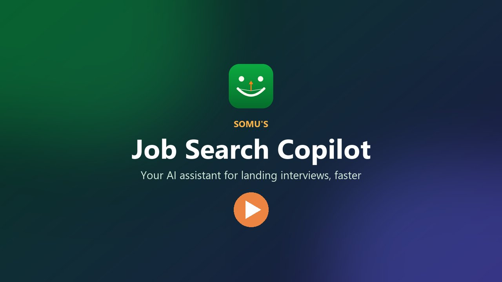
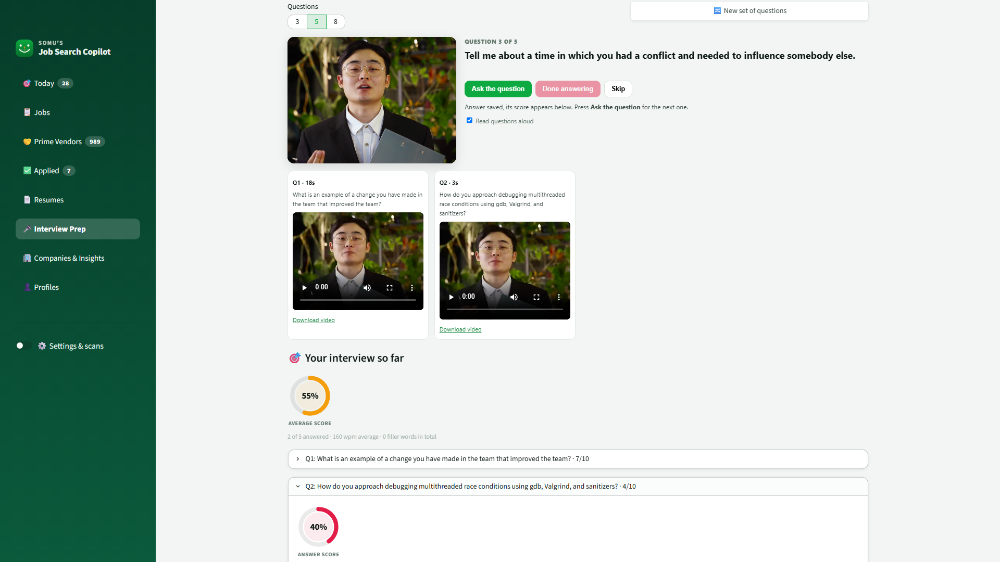
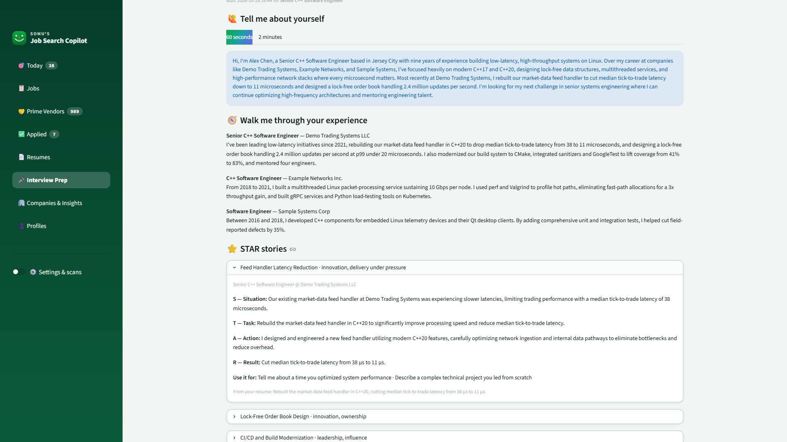
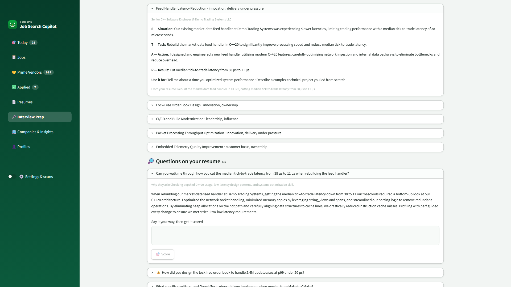
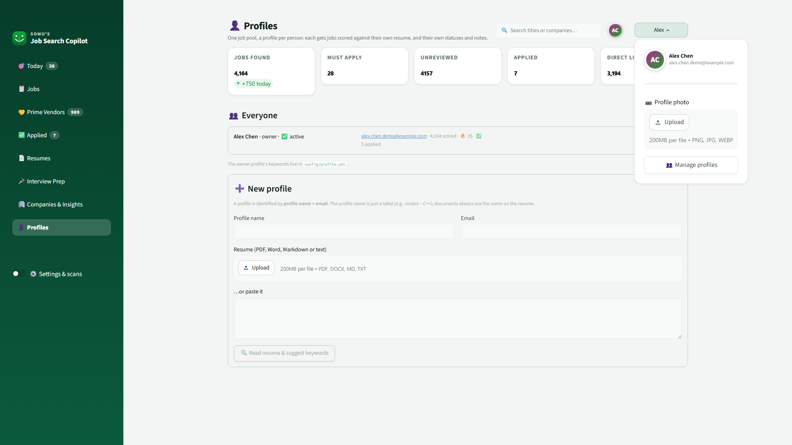
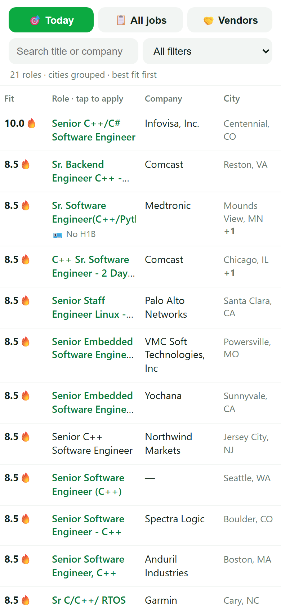
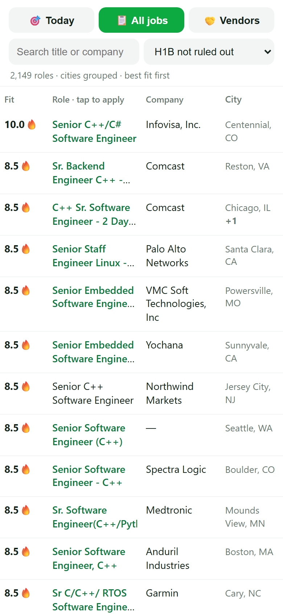
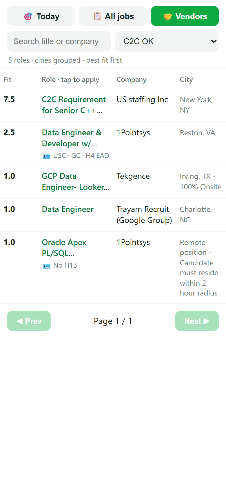
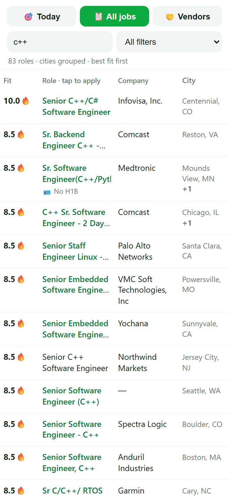

<div align="center">


# Job Search Copilot

**Find the right jobs, tailor an honest resume for each one, and apply on the employer's own site.**

[](https://calendar.app.google/ppYD1X3F3JQtjZg58)
[](https://github.com/somu-analyst/Job-Search-Copilot/issues/new?template=request-access.yml)


🌐 **[somu-analyst.github.io/Job-Search-Copilot](https://somu-analyst.github.io/Job-Search-Copilot/)**

<sub>A public live demo (sample data, fictional candidate) is on the way. Until then, book a call
for a live walkthrough.</sub>

</div>

### ▶ 4-minute product tour (with narration)

[](https://somu-analyst.github.io/Job-Search-Copilot/#tour)

<sub>Narrated walkthrough on a fictional candidate's profile: daily AI job matching across job boards, career sites, staffing vendors, C2C Google Groups and your Gmail; one row per role across cities; work-authorization filters; add any job by link; fact-checked AI resume tailoring; an AI interview coach with on-camera mock interviews and recording review; STAR stories and the questions an interviewer will ask about your own resume; applications that update from your email; and your full job table inside Telegram. Full 1080p. [Download the MP4](assets/demo.mp4)<br>On-camera footage in the mock-interview scene: stock video by Antoni Shkraba ([Pexels](https://www.pexels.com/video/man-talking-in-front-of-camera-8048256/)), free licence.</sub>

## The problem

Job searching at volume breaks in three places:

1. **Finding:** aggregators repost the same job five times and link to reposters that
   can't take an application.
2. **Tailoring:** AI resume tools happily invent experience, and that fails the
   interview or the background check.
3. **Tracking:** after 100 applications, nobody remembers which resume went where.

Job Search Copilot fixes all three, and it's been my own daily driver since July 2026.

## By the numbers

| | |
|---|---|
| **11,700+** jobs found and scored | across 2,700+ employers, from job boards, employers' own career sites, job-search APIs and recruiter groups |
| **700+** prime-vendor & recruiter jobs | from 180+ staffing firms, implementation partners and boutique recruiters, sortable by vendor size |
| **3,900+** exact employer postings | resolved automatically, so you skip the reposter |
| **3** tailored resume versions per job | each scored three ways and checked for invented claims |
| **$0** to run | free AI models, with a rule-based fallback when they're capped |
| **100** automated tests | run offline in under a second |

## How it works

```
  job boards ───────┐
  employer career   │      drop duplicates      ┌──────────────┐      Streamlit app
  sites (direct) ───┼────► score fit 1–10  ────►│  SQLite DB   │────► today's picks
  job-search APIs ──┤      tag H-1B sponsors     │  jobs        │      resume studio
  email alerts ─────┘      find the real link    │  companies   │      tracker
  C2C Google Groups ┘                            │  resumes     │
   daily scheduled scan on a cloud VM ──────────►└──────────────┘────► Telegram bot
                                                                       + Mini App table
```

1. **Find:** scans every source it can reach, daily, on an Oracle Cloud VM.
2. **Score:** rates each job 1–10 against your resume using keyword relevance (BM25)
   plus meaning-based matching that runs on the machine, with no API calls.
3. **Tailor:** writes Conservative, Balanced and ATS-max versions of your resume for
   the job, and shows what each one gains in points and costs in authenticity.
4. **Apply:** links you to the employer's own posting. Assisted apply fills the form;
   **you** press Submit.
5. **Track:** every application, its status, and the exact resume you sent.
6. **Prime vendors:** a separate view of jobs posted by staffing primes, implementation
   partners, boutique recruiters and C2C recruiter groups, filterable by vendor size
   (small / mid-size / large) and by the terms each posting states (W2, C2C, contract,
   full-time, contract-to-hire). A "W2 only, no C2C" posting is never shown as C2C.
7. **Prepare:** an AI cover letter written only from your resume and checked sentence by
   sentence, plus per-job interview prep: likely questions with STAR answers from your
   real experience, honest "gap" flags, and a practice box that grades your answers.
8. **Practise on camera:** a mock video interview that asks questions aloud, records your
   answers, and reviews each recording for content, pace and filler words.
9. **Track from Gmail:** reads application, interview, rejection and offer emails and
   moves the matching job forward, with a link back to the email.
10. **Take it with you:** a private Telegram bot sends today's picks, and its Mini App
    opens the full job table on your phone, with filters, search and one-tap apply.

## Screenshots

<sub>All screenshots use a fictional candidate (Alex Chen, Senior C++ engineer) and real public job postings.</sub>

| | |
|---|---|
| **🎯 Today**: highest-fit picks with fit rings, apply straight to the employer's own portal | **📋 Jobs**: every job, one row per role across cities, work-authorization filters |
|  |  |
| **✅ Applied**: every application, with status changes read from your email | **📄 Resume Studio**: three tailored versions, each scored and fact-checked |
|  |  |
| **🎥 Interview coach**: on-camera mock interview with a score for every answer | **⭐ STAR stories**: your real experience, ready to tell |
|  |  |
| **🔎 Questions on your resume**: what an interviewer will dig into, with a model answer | **👤 Profiles**: one job search per person, each scored against their own resume |
|  |  |

## On your phone: Telegram

A private Telegram bot sends your top picks each day. Tap **Open as table** and the Mini
App shows the same job table as the web app: Today, All jobs and Vendors tabs,
work-authorization and C2C filters, search, and Prev / Next pages. Each role links
straight to the employer's apply page. Only the owner's signed Telegram session can load
the data.

| Today's picks | Filter: H-1B not ruled out | Vendors: C2C OK | Search: c++ |
|---|---|---|---|
|  |  |  |  |

## Engineering highlights

**It catches invented experience, including the subtle kind.** Checking a tailored
resume for new skills or numbers is easy. The hard case is a sentence built from *real*
facts that were never true *together*, such as a tool from one employer paired with a
result from another. Every word is genuinely yours, so a word check passes it. Copilot
splits your resume into numbered facts, makes the AI cite the facts behind each sentence,
and then verifies those citations. It flags any claim nothing supports, any citation to a
fact that doesn't exist, and any sentence that credits the wrong employer. It costs no
extra AI call, and each version gets a fabrication rate you can compare.

**It finds the real posting, not a reposter.** For each employer it works out which
hiring system they use (Workday, Greenhouse, Lever, Ashby, SmartRecruiters and others),
queries that employer's own job listings, and remembers the answer. The directory gets
smarter with every scan.

**It never dead-ends.** AI runs on free models with automatic fallback between
providers. When every provider is capped, scoring falls back to rule-based methods, so
the app always works.

**It's private by design.** Your resume and job data live in one SQLite file that never
leaves your machine. The public demo gives each visitor their own temporary copy of the
sample data, so nothing one person does is visible to the next.

## What it deliberately does *not* do

- **It never submits an application for you.** Auto-submitters break site terms of
  service and risk a ban on the account you need most.
- **It doesn't scrape LinkedIn for recruiter emails.** It uses contacts the employer
  **published**, plus optional Hunter.io lookups.
- **It only reads public job data:** the same listings career pages already load.

## Tech stack

Python · Streamlit · SQLite · BM25 + local sentence-embedding scoring · free LLMs
(OpenRouter / Gemini) · Gmail API · Telegram Bot API + Mini App · Playwright ·
Oracle Cloud VM with systemd timers · pytest

## Work with me

The source code is private. I'm glad to walk through it, give access, or talk about a
role.

- **[Book a call](https://calendar.app.google/ppYD1X3F3JQtjZg58)** (pick a time that suits you)
- **[Request access or get in touch](https://github.com/somu-analyst/Job-Search-Copilot/issues/new?template=request-access.yml)**
- **Live demo:** coming soon

## License

© [somu-analyst](https://github.com/somu-analyst). All rights reserved. The text,
screenshots and video in this repository may not be reproduced without permission.
