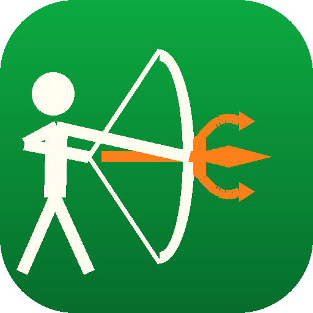
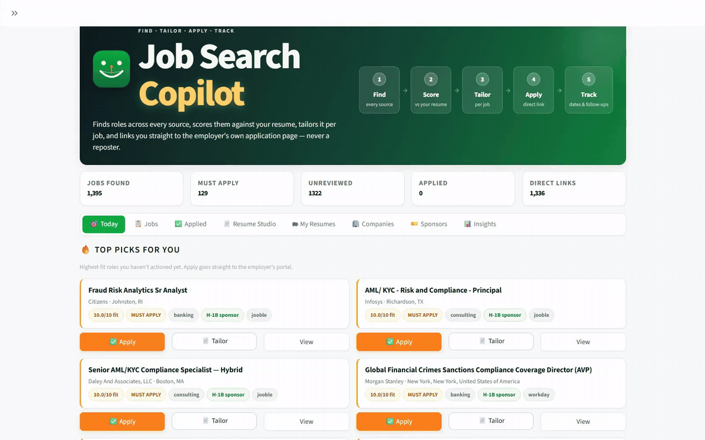
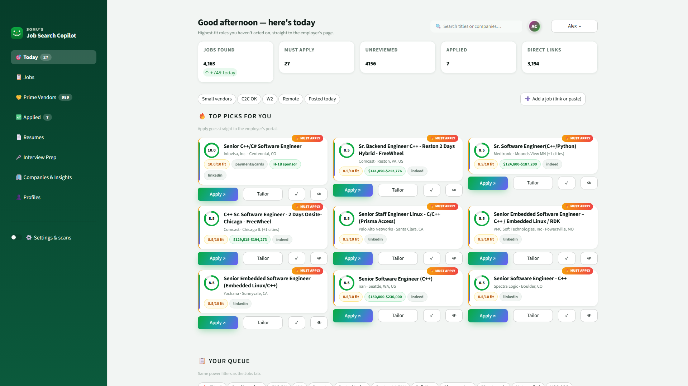
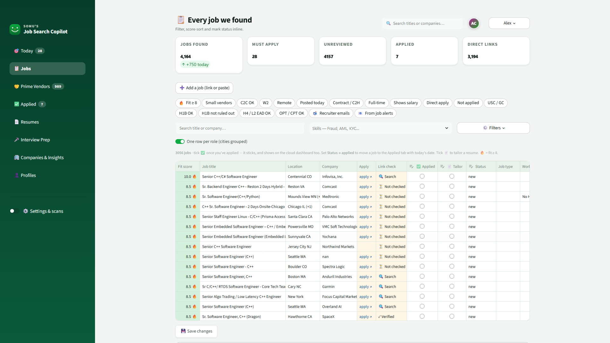
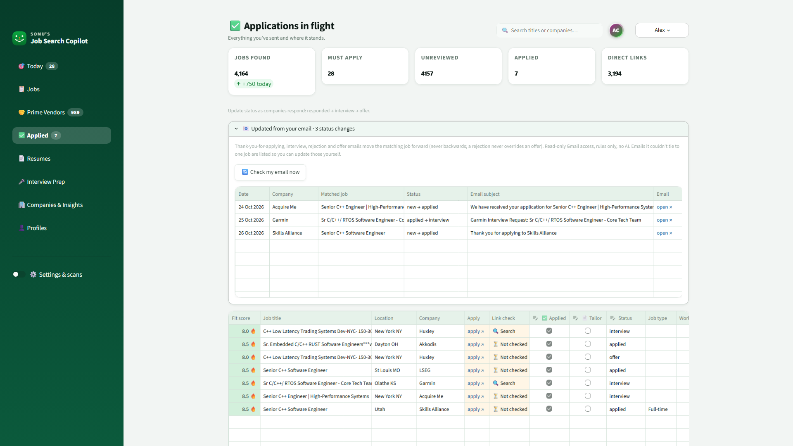
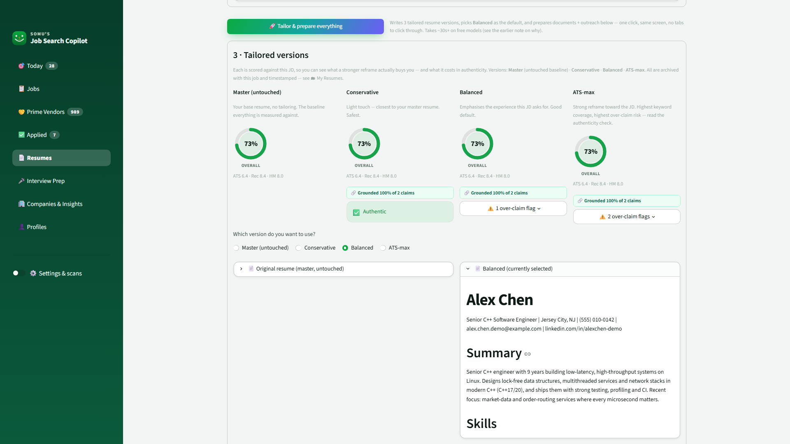
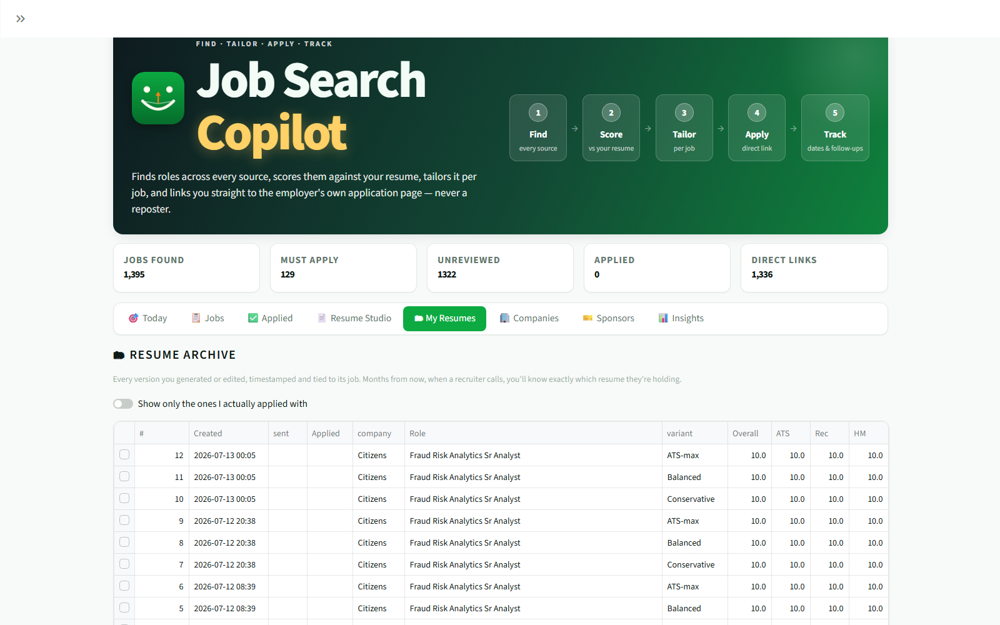
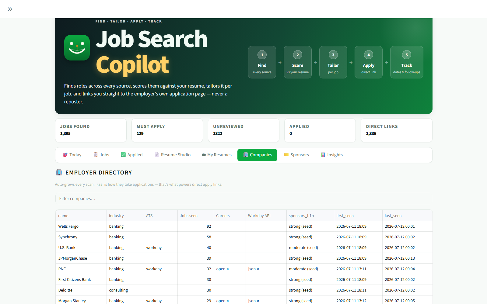
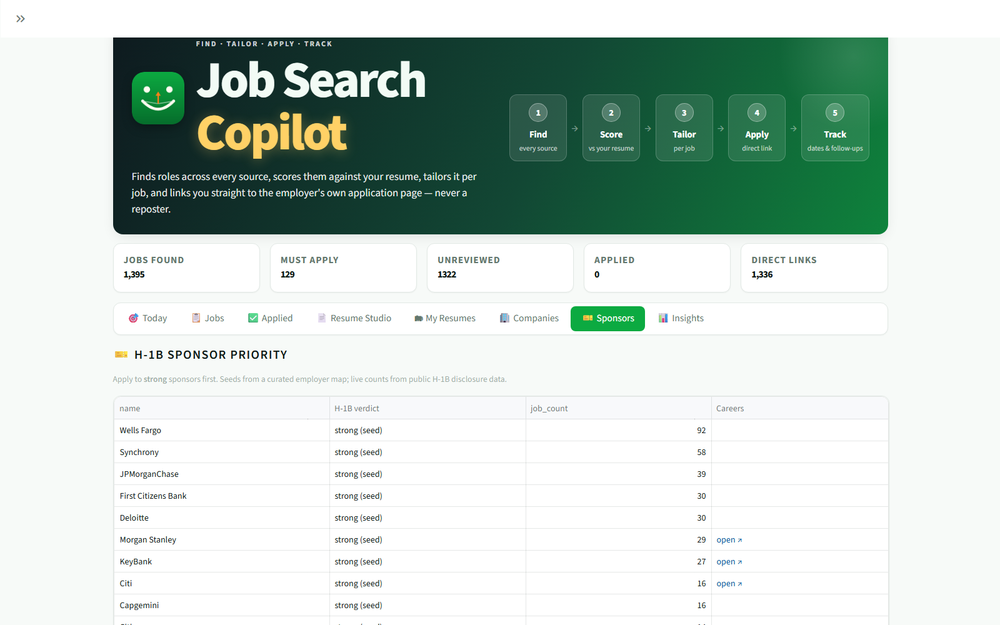
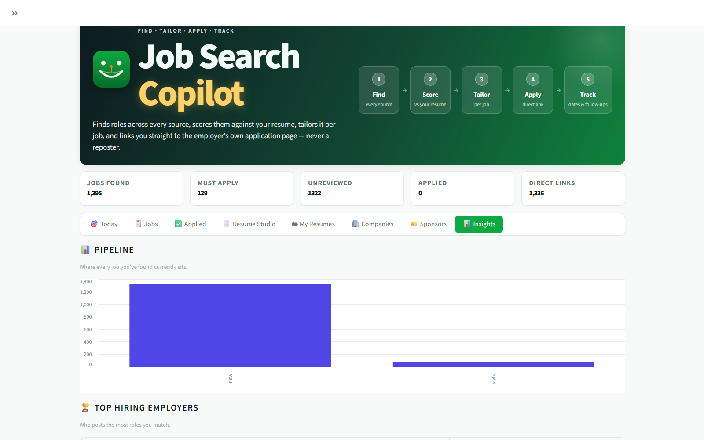

<div align="center">



# Job Search Copilot

**Find the right jobs, tailor an honest resume for each one, and apply on the employer's own site.**

[](https://somu-job-search-copilot.streamlit.app)
[](https://github.com/somu-analyst/Job-Search-Copilot/issues/new?template=request-access.yml)
[](https://calendar.app.google/ppYD1X3F3JQtjZg58)

<sub>The live demo runs on sample data with a fictional candidate. No sign-up, and you get one free AI tailoring run.</sub>

</div>



## The problem

Job searching at volume breaks in three places:

1. **Finding:** aggregators repost the same job five times and link to reposters that
   can't take an application.
2. **Tailoring:** AI resume tools happily invent experience, and that fails the
   interview or the background check.
3. **Tracking:** after 100 applications, nobody remembers which resume went where.

Job Search Copilot fixes all three, and it's been my own daily driver since July 2026.

## By the numbers

| | |
|---|---|
| **11,000+** jobs found and scored | across 2,700+ employers, from job boards, employers' own career sites and job-search APIs |
| **3,900+** exact employer postings | resolved automatically, so you skip the reposter |
| **3** tailored resume versions per job | each scored three ways and checked for invented claims |
| **$0** to run | free AI models, with a rule-based fallback when they're capped |
| **42** automated tests | run offline in under a second |

## How it works

```
  job boards ───────┐
  employer career   │      drop duplicates      ┌──────────────┐      Streamlit app
  sites (direct) ───┼────► score fit 1–10  ────►│  SQLite DB   │────► today's picks
  job-search APIs ──┤      tag H-1B sponsors     │  jobs        │      resume studio
  email alerts ─────┘      find the real link    │  companies   │      tracker
                                                 │  resumes     │
   daily scheduled scan on a cloud VM ──────────►└──────────────┘
```

1. **Find:** scans every source it can reach, daily, on an Oracle Cloud VM.
2. **Score:** rates each job 1–10 against your resume using keyword relevance (BM25)
   plus meaning-based matching that runs on the machine, with no API calls.
3. **Tailor:** writes Conservative, Balanced and ATS-max versions of your resume for
   the job, and shows what each one gains in points and costs in authenticity.
4. **Apply:** links you to the employer's own posting. Assisted apply fills the form;
   **you** press Submit.
5. **Track:** every application, its status, and the exact resume you sent.

## Screenshots

| | |
|---|---|
| **🎯 Today**: highest-fit picks, apply straight to the employer's own portal | **📋 Jobs**: every job found, filter/sort/status inline |
|  |  |
| **✅ Applied**: every application, its status and when it was sent | **📄 Resume Studio**: pick a job, score fit, AI-tailor, generate docs |
|  |  |
| **🗂 My Resumes**: every version archived, timestamped, tied to its job | **🏢 Companies**: employer directory, finds each employer's hiring system automatically |
|  |  |
| **🎫 Sponsors**: H-1B sponsor priority from public disclosure data | **📊 Insights**: what the search is turning up, over time |
|  |  |

## Engineering highlights

**It catches invented experience, including the subtle kind.** Checking a tailored
resume for new skills or numbers is easy. The hard case is a sentence built from *real*
facts that were never true *together*, such as a tool from one employer paired with a
result from another. Every word is genuinely yours, so a word check passes it. Copilot
splits your resume into numbered facts, makes the AI cite the facts behind each sentence,
and then verifies those citations. It flags any claim nothing supports, any citation to a
fact that doesn't exist, and any sentence that credits the wrong employer. It costs no
extra AI call, and each version gets a fabrication rate you can compare.

**It finds the real posting, not a reposter.** For each employer it works out which
hiring system they use (Workday, Greenhouse, Lever, Ashby, SmartRecruiters and others),
queries that employer's own job listings, and remembers the answer. The directory gets
smarter with every scan.

**It never dead-ends.** AI runs on free models with automatic fallback between
providers. When every provider is capped, scoring falls back to rule-based methods, so
the app always works.

**It's private by design.** Your resume and job data live in one SQLite file that never
leaves your machine. The public demo gives each visitor their own temporary copy of the
sample data, so nothing one person does is visible to the next.

## What it deliberately does *not* do

- **It never submits an application for you.** Auto-submitters break site terms of
  service and risk a ban on the account you need most.
- **It doesn't scrape LinkedIn for recruiter emails.** It uses contacts the employer
  **published**, plus optional Hunter.io lookups.
- **It only reads public job data:** the same listings career pages already load.

## Tech stack

Python · Streamlit · SQLite · BM25 + local sentence-embedding scoring · free LLMs
(OpenRouter / Gemini) · Playwright · Oracle Cloud VM with systemd timers · pytest

## Work with me

The source code is private. I'm glad to walk through it, give access, or talk about a
role.

- **[Book a call](https://calendar.app.google/ppYD1X3F3JQtjZg58)** (pick a time that suits you)
- **[Request access or get in touch](https://github.com/somu-analyst/Job-Search-Copilot/issues/new?template=request-access.yml)**
- **[Try the live demo](https://somu-job-search-copilot.streamlit.app)**

## License

© [somu-analyst](https://github.com/somu-analyst). All rights reserved. The text,
screenshots and video in this repository may not be reproduced without permission.
